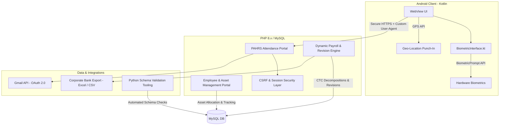

# Enterprise Operations, HRMS & Mobile Attendance Ecosystem (AI-Assisted Architecture)

[](#)
[](#)
[](#)

A production-grade, internal **Human Resource, IT Asset Lifecycle & Payroll Management Ecosystem** architected, deployed, and maintained for **80+ enterprise employees and distributed recruiters**.

This repository contains sanitized architecture blueprints, security helpers, mobile interfaces, and backend modules developed using modern **AI-assisted engineering workflows (Google Antigravity / Gemini)**.

---

## 🏛️ System Architecture



---

## 📂 Repository Contents

```
Sanitized Code/
├── android/
│   ├── MainActivity.kt            # Android WebView wrapper with GPS, FilePicker & Custom User-Agent
│   └── BiometricInterface.kt      # Native BiometricPrompt bridge exposed to JS runtime via @JavascriptInterface
│
├── backend/
│   ├── csrf_helpers.php           # Cryptographic CSRF token generation & 10-minute inactivity session timeout
│   ├── getAttendance_api.php      # JSON REST API endpoint with API-Key authentication & prepared statements
│   └── gmail_oauth_config.php     # Google Gmail API OAuth 2.0 offline client with auto-refresh mechanism
│
├── employee_portal/
│   ├── asset_management.php       # IT hardware tracking, serial numbers, allocation/return & duplicate checks
│   ├── salary_revision_engine.php # Dynamic CTC breakdown, statutory deductions (PF/ESI) & audit trail
│   ├── bank_excel_export.php      # Bulk corporate bank disbursement generator with account validation
│   └── db_schema_inspector.py     # Python utility for automated database schema validation
│
└── README.md                      # Project documentation & architectural overview
```

---

## 🚀 Key Functional Modules

### 1. IT Asset & Hardware Lifecycle Management (`employee_portal/asset_management.php`)
- **Lifecycle Tracking:** Manages laptop, desktop, mobile device, and security access card allocation for all active personnel.
- **Duplicate Prevention:** Executes pre-flight queries inside atomic database transactions (`PDO::beginTransaction`) to prevent allocating the same serial asset to multiple working employees.
- **Audit Trails:** Automatically logs all hardware handovers, reassignments, and custody sign-offs in a dedicated `asset_history` log.

### 2. Dynamic Payroll Engine & Bank Integration (`employee_portal/`)
- **Automated CTC Decomposition:** Automatically computes Basic, HRA, Medical, Conveyance, Gross Salary, and statutory deductions (EPF, ESI).
- **Disbursement Pipeline:** Validates employee banking beneficiary records (Account Number, IFSC Code) and generates standardized corporate bank upload files for seamless salary distribution.
- **Self-Healing Schema:** Automatically checks and provisions missing audit tables at runtime without manual intervention.

### 3. Native Android Biometric Attendance (`android/`)
- **Biometric Integration:** Seamlessly bridges Android's native `androidx.biometric.BiometricPrompt` with the web portal runtime using `@JavascriptInterface`, allowing web-driven biometric authorization.
- **Location Verification:** Enforces GPS geolocation capture during punch-in to prevent proxy attendance.
- **Client Identification:** Injects a dedicated User-Agent identifier (`ENTERPRISE_MOBILE_APP`) enabling the server to serve mobile-optimized layouts and restrict unauthorized desktop access.

### 4. Security & Data Integrity (`backend/`)
- **CSRF Defense:** Generates 256-bit entropy cryptographic tokens (`random_bytes(32)`) validated via constant-time comparison (`hash_equals`).
- **Inactivity Session Expiry:** Server-enforced 10-minute idle session timeout.
- **Python Automation Tooling:** Python inspection scripts (`db_schema_inspector.py`) to verify database schema consistency and table definitions across deployment environments.

---

## 🛡️ Confidentiality & Sanitization Notice
All corporate database credentials, live server endpoints, internal employee records, bank account details, and proprietary production keys have been redacted and replaced with configurable environment variables and mock schemas.
